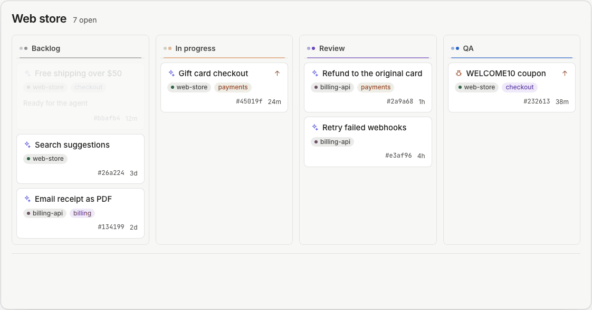
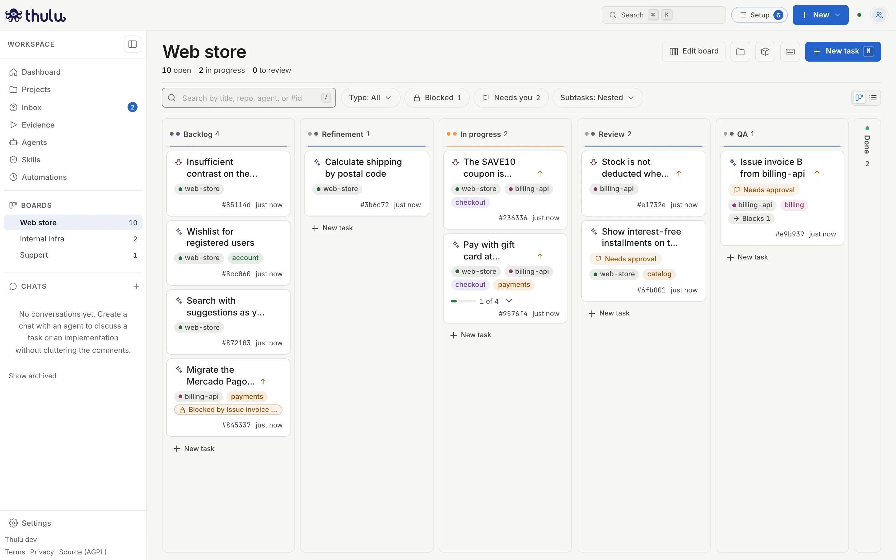
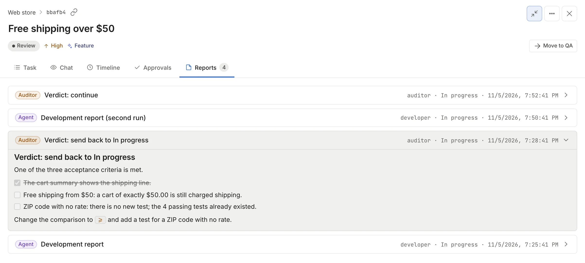
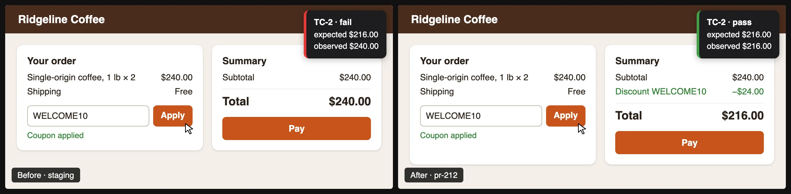
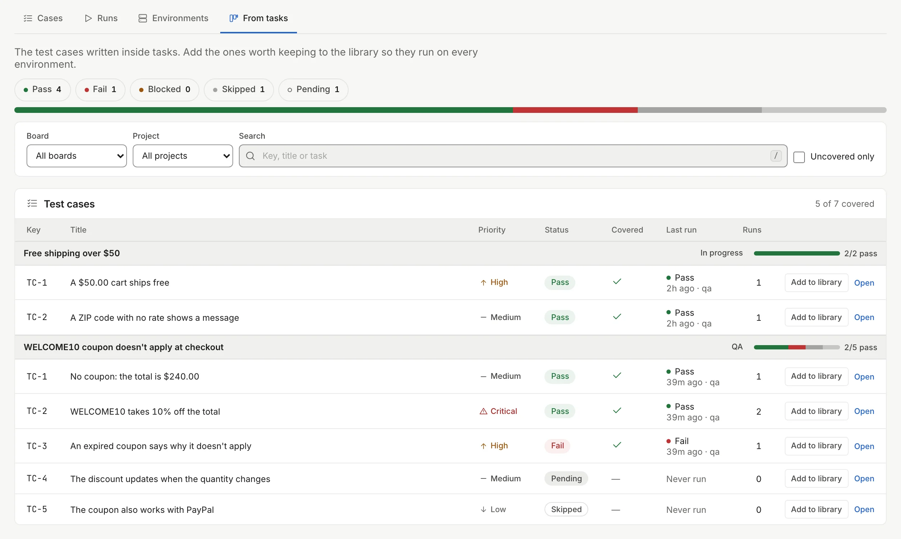
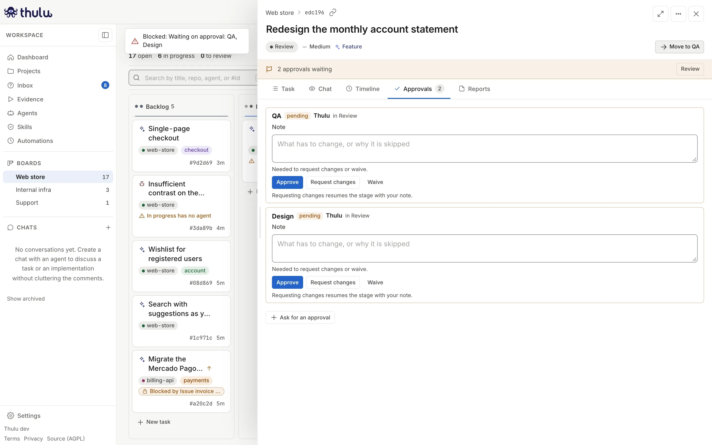
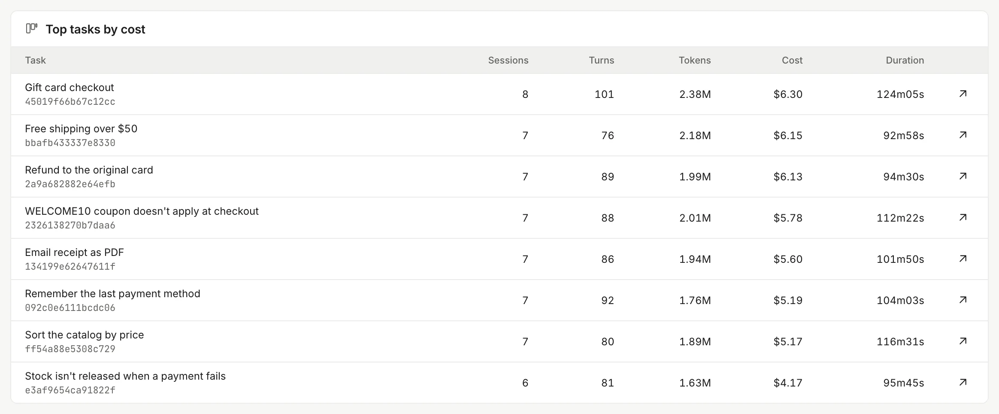

<picture>
  <source media="(prefers-color-scheme: dark)" srcset=".github/assets/thulu-lockup-on-dark.svg">
  
</picture>

# AI agents run your delivery process. You decide what merges.

Thulu is a self-hosted task board for software teams. Each stage of your board gets its own agent. An auditor you turn on can check the work before it moves on, a QA agent sends back a video of each test, and by default no agent can merge. It runs on your servers and talks to the model with your own key.

[Website](https://thulu.dev) · [Docs](https://thulu.dev/docs/) · [Pricing](https://thulu.dev/#pricing) · [What it doesn't do](#what-it-doesnt-do) · [Español](https://thulu.dev/es/)

<picture>
  <source media="(prefers-color-scheme: dark)" srcset=".github/assets/readme/board-flow-dark.gif">
  
</picture>

<sub>A drawing of the board, with made-up data: one task goes through the agent, the auditor and QA, and comes back with its PR. The captures further down are the real dashboard.</sub>

## Try it

```bash
curl -fsSL https://github.com/MisterDonnuts/thulu/releases/latest/download/install.sh | sh
```

The installer downloads the `thulu` CLI for your platform, checks it against the release checksums (and the signature, when `cosign` is installed) and offers to run `thulu init`. Choose **Quick, on this machine**: Docker with the published image, no login, reachable only at `http://127.0.0.1:8585`. It asks for the engines, the runner and GitHub; everything else takes its default and shows up in the summary.

The images are published for linux/amd64 and linux/arm64, so an Apple Silicon Mac runs them natively. Measured there: the first `thulu init` downloads about 630 MB of images, then the stack answers in about 15 seconds and uses about 250 MB of memory. The first agent run of an install adds about 5 seconds while Claude Code installs from npm into a volume every later run reuses.

For the first agent run you need:

- Docker with Compose 2.24 or later
- a model credential for the engine you pick: an Anthropic API key, Amazon Bedrock or Google Vertex for Claude Code, an OpenAI key for Codex, any OpenAI-compatible API for OpenCode
- a GitHub repository the agent can push a branch to

A new workspace has no agents: create one or install a sample from the Workshop, assign it to a stage, and create a task.

The command is `thulu`. Environment variables, images and the Helm chart use the name `octopus` (`OCTOPUS_*`).

## One task, from an empty board to a merge

### 1. Lay out your stages

A new board starts as Backlog, In progress, Done. Make it Backlog, Development, QA, Human review, Done, or whatever your team uses, with up to 32 stages per board and 64 boards per workspace. You decide which stages get an agent, which advance on their own, and which wait for a person's approval. Task types can skip stages, so a hotfix doesn't go through refinement.



### 2. Give each stage an agent

Every agent has its own prompt, model, tools and permissions for each stage. The development agent can push while it's in Development; the QA agent gets a browser in QA. None come preinstalled: you write your agents for your stack or import them, and the Workshop has two sample agents and one sample skill to start from.

Claude Code is the main engine. Codex and OpenCode also run agents and auditors, and a stage's auditor can use a different engine from its agent.

### 3. Create a task and let the agent work

The agent works on its own branch in its own sandbox, where it starts your app with the project's init script. Its key lasts 24 hours at most, dies when the run ends, and can only change its own task. The GitHub token stays in the daemon, outside the agent's container. A task can span several repos, with one worktree and one PR per repo.

When the agent needs something only a person knows, it asks in the task. A blocking question parks the task with no container running, and the agent resumes the same session when it is answered.

### 4. The auditor sends it back if something's missing

You turn an auditor on per agent and stage; a new install has none on. It checks the result against your definition of done, in its own container with the repo mounted read-only, and can pass the task, send it back to another stage or block it. The task goes back with the reason, and the next run picks it up from there.

<picture>
  <source media="(prefers-color-scheme: dark)" srcset=".github/assets/readme/auditor-kickback-dark.webp">
  
</picture>

### 5. Get a video of every test

The QA agent, which you also define, runs the app in a real browser, records each case and marks it pass or fail. Every case has a check the tool measures, and measures again each time the test replays. The take is saved to your repo as JSON, and Thulu replays it on another task without a model.



<sub>A recreated frame of a QA video, on a made-up shop: the same test against staging and against the PR's branch.</sub>

<picture>
  <source media="(prefers-color-scheme: dark)" srcset=".github/assets/readme/evidence-from-tasks-dark.webp">
  
</picture>

### 6. A person approves and merges

The task shows the PR with its CI and review. A stage can require approvals, an agent can request one, and a person can add one; any of them holds the task in its stage. Only a person with the developer role or above decides, and an agent never approves.

Merging is a tool (`pr_merge`) that no write permission includes: an admin has to name it on the stage where they want it. If nobody does, no agent can merge.



## See where the money went

You pay your model provider directly, on your key. Thulu shows cost and tokens per task, agent, model and project, plus lead time, rework and first-pass rate. We don't publish a figure for model cost or for how much faster you'll ship: you measure both on your own tasks.

<picture>
  <source media="(prefers-color-scheme: dark)" srcset=".github/assets/readme/usage-top-tasks-dark.webp">
  
</picture>

<sub>The captures come from a demo workspace with made-up tasks.</sub>

## Also included

- **Isolation.** Agents build and run the app in a per-task container (Docker) or pod (Kubernetes). On Kubernetes the app's preview is reachable only from the pods of the same task.
- **Your model key, your sign-in.** Anthropic, Amazon Bedrock or Google Vertex (Codex and OpenCode also take OpenAI and OpenAI-compatible APIs such as DeepSeek), per workspace, stored encrypted with AES-256-GCM. SSO over OIDC (one issuer per installation) or GitHub, with IdP groups mapped to four fixed roles; there are no local accounts. AWS, GCP and GitHub credentials are granted per project, environment or workspace.
- **Audit.** A hash-chained audit log per workspace with 62 event types, exportable as CSV or NDJSON (licensed).
- **The rest.** Automations (cron, GitHub and board events, metric thresholds), signed outbound webhooks, a persistent chat with an agent, Prometheus `/metrics`, manual updates with a database snapshot and rollback, workspace export and import, and a dashboard, API and CLI in English and Spanish.

The [docs index](docs/README.md) covers each one.

## What it doesn't do

- **It isn't a swarm.** Each task has one agent per stage, plus the auditor.
- **Claude Code is the main engine.** Live messages to a running agent and the runner on your machine need Claude Code, and Codex gets its skills pasted into the prompt.
- **Pull requests only on GitHub** (github.com and GitHub Enterprise Server). No GitLab or Bitbucket.
- **No egress filter in Docker.** Agents get trimmed capabilities and their own network, and the daemon controls the host's Docker through its socket. Egress control (`open` or `proxy-only`) exists only on the Kubernetes runtime.
- **The Kubernetes runtime needs a license** and has been validated on a single k3s node with Kata.
- **It starts with no agents.** A new workspace has no agents and the factory board has no approvals: your team defines both.
- **Evidence covers web apps** in Chromium, also at phone size. No native mobile apps.
- **No native Slack or Jira integration**, only outgoing webhooks and automations with HTTP steps.
- **No SOC 2 or ISO certification.**
- **No telemetry, but your code does reach your model provider.** The daemon checks the GitHub API for new releases every 12 hours, without an identifier; `OCTOPUS_UPDATE_SOURCE=off` turns that off. Agents send the code they read to the provider behind your key.

## License and plans

| | What's in it |
|---|---|
| Core, [AGPL-3.0](LICENSE) | Boards, stages, agents, auditor, QA on video, the Docker sandbox, SSO, the audit log in the dashboard, multiple workspaces |
| [`ee/`](ee/LICENSE), needs a license key | Audit log export, the Kubernetes runtime, Stripe billing |

Free covers teams of up to 4 people, Team starts at the 5th, and Enterprise adds a contract, an SLA and a named contact. Thulu doesn't enforce those sizes: only the features in `ee/` need a key, and workspaces, people and runs have no limit without one.

Prices are public at [thulu.dev](https://thulu.dev/#pricing), and you don't need a call to see them. To buy, [contact sales](https://thulu.dev/contact/). The managed cloud is a [closed beta, invitation only](https://thulu.dev/getting-started/cloud/).

The core is licensed under the [GNU AGPL v3.0 only](LICENSE) (`AGPL-3.0-only`), with the [additional permission](LICENSE-EXCEPTION) to combine it with `ee/`, and runs on its own as the Community Edition. The `ee/` directory is under the [Thulu Enterprise License](ee/LICENSE). See [docs/ee-licensing.md](docs/ee-licensing.md).

## Production install

Run `thulu init` and choose **Custom Docker** (a domain with HTTPS, SSO or GitHub sign-in, your own database) or **Kubernetes / k3s** (values for the Helm chart; needs a license). The setup reference is [docs/enterprise-setup.md](docs/enterprise-setup.md), the environment variables and backups are in [docs/deploy.md](docs/deploy.md), and updates are in [docs/upgrade-guide.md](docs/upgrade-guide.md).

## Build from source

Building needs:

- Go 1.26.11 (`go.mod`)
- Node.js 22.23.4 or later, with npm
- Docker with Compose 2.24 or later
- gcc, for the race detector in `make test`

Release images are built for linux/amd64 and linux/arm64. Images you build with `make agent-images` use your machine's architecture.

```bash
git clone https://github.com/MisterDonnuts/thulu.git && cd thulu
make build-web
```

`make build-web` installs the dashboard's dependencies when they are missing and builds `web/dist/`, which the Go binary embeds: run it before any `go run` or `go build`.

Then bring up the development stack, which runs everything in containers (daemon rebuilt by `air` on save, dashboard on Vite at `http://localhost:4321`, API at `http://localhost:8585`). The first time:

```bash
go run . init -stack deploy/docker-compose.dev.yml
```

After that, `make dev` starts it again. A source build runs agents and sandboxes on images you build with `make agent-images`. The rest (tests, the built stack with `make up`, linting) is in [docs/development.md](docs/development.md#run-it).

Thulu runs only in containers: the daemon launches agents as sibling containers over the Docker socket, so a daemon running as a host process is not supported. Outside dev mode the daemon refuses to start without `OCTOPUS_JWT_SECRET` (generate one with `openssl rand -hex 32`).

## Contributing and security

[CONTRIBUTING.md](CONTRIBUTING.md) explains how to send a change, and [SECURITY.md](SECURITY.md) how to report a vulnerability.
